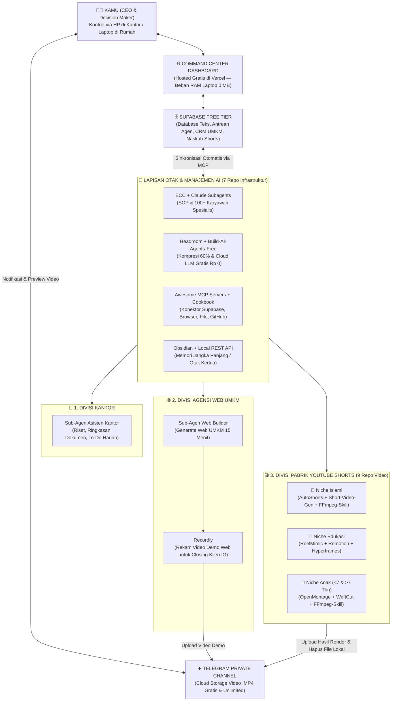

# 🏛️ MASTER BLUEPRINT ECOSYSTEM: Sistem Operasi Bisnis & AI Otonom (3 Sumber Penghasilan)

Dokumen ini adalah **Cetak Biru Utama (Single Source of Truth)** yang menyatukan seluruh perencanaan bisnis, pemetaan **16 Repositori GitHub Open-Source**, optimasi perangkat keras laptop **MSI Modern 14 (RAM 8GB)**, arsitektur **Cloud Dashboard (Vercel + Supabase Gratis + Telegram Unlimited Cloud)**, hingga peta jalan eksekusi harian.

---

## 🎯 BAB 1: Visi Utama — 1 Direktur, 3 Mesin Penghasilan, 1 Dashboard Kendali

Tujuan utama sistem ini adalah memungkinkan kamu mengelola **3 sumber penghasilan sekaligus** tanpa *burnout* (kelelahan), dengan memposisikan kamu sebagai **CEO / Pengambil Keputusan** dan menyerahkan 80% pekerjaan teknis berulang kepada **Tim Sub-Agen AI**.

1. **💼 Penghasilan 1: Pekerjaan Kantoran (Stabilitas Utama)**
   * *Peran AI:* Merangkum dokumen rapat, meriset tugas kantor, mengotomasi laporan, dan mengatur jadwal harian.
2. **🌐 Penghasilan 2: Agensi Freelance Web UMKM (Cashflow Cepat / Mingguan)**
   * *Peran AI:* Mengubah prospek dari Instagram yang sudah kamu bangun menjadi klien berbayar lewat pembuatan *prototype* website kilat (15 menit) dan rekaman demo layar via `Recordly`.
3. **🎬 Penghasilan 3: Pabrik Ternak Akun YouTube Shorts (Aset Pasif Jangka Panjang)**
   * *Peran AI:* Memproduksi video pendek otomatis setiap hari untuk **3 Niche Berbeda** (*Shorts Islami*, *Shorts Edukasi*, serta *Shorts Anak <7 Tahun & >7 Tahun*).



---

## 💻 BAB 2: Profil Perangkat Keras & Aturan Optimasi (Sangat Krusial)

Berdasarkan hasil pemeriksaan sistem laptop kamu:
* **Perangkat:** MSI Modern 14 C12MO (Windows 11 Home)
* **Prosesor (CPU):** 12th Gen Intel Core i5-1235U (10 Cores, 12 Threads) — *Kencang untuk multitasking skrip & pemrograman.*
* **RAM:** **8 GB** (Terbaca 7.7 GB, pemakaian normal sudah mencapai **6.9 GB / 90%**, sisa ruang kosong **~827 MB**).
* **Kartu Grafis (GPU):** Intel Iris Xe Graphics (*Integrated GPU*).
* **Penyimpanan:** SSD NVMe.

> [!CAUTION]
> **5 Hukum Besi untuk Laptop RAM 8 GB (Agar Tidak Pernah Hang/Lag):**
> 1. **DILARANG Menjalankan LLM Lokal (Ollama/Llama/DeepSeek Lokal):** Otak AI wajib menggunakan **API Cloud Gratis** (Groq API, Google Gemini Free Tier, OpenRouter Free) sesuai panduan `build-ai-agents-free`. Beban RAM laptop untuk kecerdasan AI = **0 MB**.
> 2. **DILARANG Menjalankan Server Dashboard Lokal 24 Jam:** Dashboard utama di-*host* di **Vercel (Cloud)** dan database di **Supabase (Cloud)**, sehingga tidak memakan RAM laptop.
> 3. **Utamakan Render Video via CLI (`ffmpeg-skill` + Intel QuickSync `h264_qsv`):** Hindari membuka aplikasi editor video berat bersamaan dengan belasan tab browser. Gunakan jalur baris perintah (`FFmpeg`) yang memanfaatkan akselerasi hardware **Intel Iris Xe**.
> 4. **Gunakan Groq Whisper API (Cloud Gratis) untuk Subtitle Otomatis:** Saat `AutoShorts` atau `short-video-generator-AI` membuat *subtitle*, arahkan ke API Groq Whisper gratis agar CPU & RAM laptop tidak terbebani proses transkripsi lokal.
> 5. **Auto-Delete Video Setelah Masuk Telegram:** Begitu video selesai di-*render* dan otomatis di-*upload* ke Telegram Private Channel, skrip agen wajib menghapus file `.mp4` mentah di laptop agar SSD tetap lega.

---

## 🧩 BAB 3: Pemetaan Lengkap 16 Repositori GitHub

Seluruh 16 repositori yang kamu kumpulkan dibagi menjadi **2 Kelompok Besar** yang saling bekerja sama:

### Kelompok A: 7 Repositori Infrastruktur Inti AI (Otak, Memori, Penghemat Biaya & Tangan AI)

| No | Nama Repositori | Peran Spesifik di Dalam Ekosistem Bisnis Kamu |
| :--- | :--- | :--- |
| 1 | **`headroomlabs-ai/headroom`** | **Penghemat Kuota & Kompresor Konteks.** Memadatkan *prompt*, kode, dan log hingga 60% dalam <1 milidetik sebelum dikirim ke AI agar kuota API hemat dan AI tidak lemot. |
| 2 | **`coddingtonbear/obsidian-local-rest-api`** | **Jembatan Memori Jangka Panjang.** Menghubungkan aplikasi catatan Obsidian di laptopmu dengan AI Agent untuk menyimpan SOP, data detail klien UMKM, dan arsip riset kantor. |
| 3 | **`affaan-m/ECC`** *(Everything Claude Code)* | **Manajer Operasional & SOP Agen.** Mengatur tata tertib kerja asisten koding agar selalu melakukan perencanaan (*Plan*), eksekusi rapi, dan verifikasi otomatis. |
| 4 | **`Moh4696/build-ai-agents-free`** | **Mesin Agen AI Rp 0.** Cetak biru untuk merakit agen pekerja harian menggunakan model AI Cloud gratis tanpa biaya langganan bulanan. |
| 5 | **`anthropics/anthropic-cookbook`** | **Buku Resep Logika AI Tingkat Lanjut.** Referensi kode resmi untuk fitur RAG (baca PDF kantor), ekstraksi data JSON rapi, dan pembuatan fitur AI untuk klien UMKM. |
| 6 | **`punkpeye/awesome-mcp-servers`** | **Tangan & Kaki AI (Konektor Universal).** Menyediakan konektor siap pakai agar AI bisa mengakses Supabase, Browser (riset tren), GitHub (deploy web UMKM), dan sistem file lokal. |
| 7 | **`awesome-claude-code-subagents`** | **100+ Karyawan Virtual Spesialis.** Membagi AI menjadi tim khusus: *Sub-Agen Web Dev UMKM*, *Sub-Agen Scriptwriter Shorts*, *Sub-Agen Video Producer*, dan *Sub-Agen Asisten Kantor*. |

---

### Kelompok B: 9 Repositori Pabrik Konten Video & Senjata UMKM

Setiap niche YouTube Shorts dan bisnis UMKM memiliki karakteristik visual yang berbeda, sehingga dipetakan sebagai berikut:

| Divisi / Niche | Repositori yang Digunakan | Cara Kerja Otomatisasi di Sistem Kamu |
| :--- | :--- | :--- |
| **🕌 Niche 1: Shorts Islami**<br>*(Kajian, Kisah Nabi, Tadabbur)* | • `JayWebtech/autoshorts`<br>• `pierrenade/short-video-generator-AI`<br>• `kajisho5/ffmpeg-skill` | Mengambil video ceramah/kajian panjang berizin $\rightarrow$ memotong bagian paling menyentuh (15–60 detik) $\rightarrow$ *auto-crop* wajah penceramah ke tengah layar vertikal (9:16) $\rightarrow$ tambah *subtitle* otomatis & audio latar menyejukkan via `ffmpeg-skill`. |
| **🧠 Niche 2: Shorts Edukasi**<br>*(Fakta Sains, Sejarah, Tekno)* | • `edenfunf/reelmimic`<br>• `remotion-dev/remotion`<br>• `heygen-com/hyperframes` | `reelmimic` membedah pola *hook* dan *pacing* video edukasi luar negeri yang viral $\rightarrow$ AI menulis naskah baru di topik serupa $\rightarrow$ `Remotion` & `Hyperframes` mengubah naskah tersebut menjadi video animasi grafik (*motion graphics*) profesional lewat kode React/teks! |
| **🧸 Niche 3: Shorts Anak**<br>*(<7 Thn: Warna/Hewan/Cerita)*<br>*(>7 Thn: Kuis/Sains Anak)* | • `calesthio/OpenMontage`<br>• `WeftCut/WeftCut`<br>• `kajisho5/ffmpeg-skill` | `OpenMontage` bertindak sebagai studio produksi penuh: merancang *storyboard* cerita/kuis anak, menggabungkan ilustrasi ceria, *voiceover* ramah anak, dan efek suara lucu. `WeftCut` dipakai jika butuh polesan editan visual cepat. |
| **🌐 Divisi Web UMKM**<br>*(Konversi Klien Instagram)* | • `webadderallorg/Recordly` | Setelah Sub-Agen membuatkan *demo website* untuk calon klien UMKM dari Instagram, gunakan `Recordly` untuk merekam layar selama 60 detik sambil menyapa klien. Video dikirim via Telegram/WA agar klien langsung percaya dan *closing*! |

---

## ☁️ BAB 4: Analisis Kapasitas Cloud Gratis (Vercel + Supabase + Telegram)

Sistem ini dirancang agar berjalan dengan **Biaya Infrastruktur Rp 0 / Bulan** namun sanggup menangani ribuan proses.

### 📊 1. Tabel Kuota Gratis Supabase vs Pemakaian 1 Tahun Penuh

| Fitur Supabase | Jatah Gratis (Free Tier) | Hitungan Pemakaian Kamu (1 Tahun Penuh) | Status Keamanan |
| :--- | :--- | :--- | :--- |
| **API Requests** | **UNLIMITED (Tak Terbatas)** | Ribuan *request* per hari dari Dashboard Vercel, HP, dan AI Agent di laptop | 🟢 **Aman 100%** |
| **Database (PostgreSQL)** | **500 MB** | • 3.650 Naskah Shorts/thn (~18,25 MB)<br>• 1.000 Data Klien UMKM/thn (~4 MB)<br>• 3.650 Catatan Kantor & Obsidian/thn (~11 MB)<br>• Log AI Agent 30 hari (~5 MB)<br>**Total = ~38,25 MB / tahun (Baru 7,6%!)** | 🟢 **Cukup hingga >10 Tahun** |
| **File Storage** | **1 GB** | Hanya untuk *thumbnail* kecil atau aset statis (Video disimpan di Telegram!) | 🟢 **Aman 100%** |
| **Bandwidth Keluar** | **5 GB / bulan** | Sinkronisasi teks JSON & buka Dashboard harian (~200 MB / bulan) | 🟢 **Aman 100%** |
| **Realtime Connections** | **200 koneksi bersamaan** | Hanya dipakai oleh HP kamu, Laptop, dan Sub-Agen (~5 koneksi) | 🟢 **Aman 100%** |

### 🛡️ 2. Strategi Anti-Jebakan Cloud Gratis
1. **Penyimpanan Video Unlimited di Telegram (`Telegram Private Channel + Bot API`):**
   * File video `.mp4` hasil render **TIDAK PERNAH** di-*upload* ke Supabase Storage, melainkan langsung dikirim oleh Bot AI ke **Channel Telegram Pribadi** milikmu (Gratis, kuota *unlimited*, batas ukuran hingga 2 GB per file).
   * Supabase hanya menyimpan `telegram_file_id` dan `telegram_message_url` (berukuran beberapa *byte* teks saja).
2. **Anti Auto-Pause Supabase (7 Hari Pasif):**
   * Kita memasang **Vercel Cron Job otomatis setiap jam 07.00 pagi** yang membangunkan database untuk menyiapkan *To-Do List* harian dan ide konten pagi. Dengan begitu, database Supabase kamu tidak akan pernah tertidur (*paused*).

---

## 🗄️ BAB 5: Skema Database Inti Supabase (SQL Siap Pakai)

Salin dan jalankan perintah SQL berikut di menu **SQL Editor** pada akun Supabase kamu untuk membuat fondasi seluruh sistem:

```sql
-- 1. TABEL KERJAAN KANTOR & TUGAS HARIAN (Sinkron dengan Obsidian)
CREATE TABLE office_tasks (
    id UUID DEFAULT gen_random_uuid() PRIMARY KEY,
    title TEXT NOT NULL,
    category TEXT DEFAULT 'Kantor', -- 'Kantor', 'Pribadi', 'Riset'
    priority TEXT DEFAULT 'Medium', -- 'High', 'Medium', 'Low'
    status TEXT DEFAULT 'Todo',     -- 'Todo', 'In Progress', 'Done'
    due_date TIMESTAMPTZ,
    ai_summary TEXT,                -- Rangkuman otomatis dari AI Agent
    obsidian_path TEXT,             -- Path file catatan di Obsidian lokal
    created_at TIMESTAMPTZ DEFAULT NOW()
);

-- 2. TABEL AGENSI FREELANCE WEB UMKM (CRM & Pipeline Klien IG)
CREATE TABLE umkm_clients (
    id UUID DEFAULT gen_random_uuid() PRIMARY KEY,
    business_name TEXT NOT NULL,
    niche TEXT,                     -- 'Kuliner', 'Jasa', 'Fashion', 'Klinik', 'Kontraktor'
    instagram_handle TEXT,
    whatsapp_number TEXT,
    status TEXT DEFAULT 'Lead',     -- 'Lead', 'Demo_Dibuat', 'Video_Dikirim', 'Closing', 'Lunas'
    demo_web_url TEXT,              -- Link preview web UMKM di Vercel
    recordly_telegram_url TEXT,     -- Link video demo Recordly di Telegram
    price_deal NUMERIC DEFAULT 0,
    ai_notes TEXT,                  -- Catatan analisis kebutuhan klien oleh AI
    created_at TIMESTAMPTZ DEFAULT NOW()
);

-- 3. TABEL PABRIK YOUTUBE SHORTS (3 Niche: Islami, Edukasi, Anak)
CREATE TABLE youtube_shorts_queue (
    id UUID DEFAULT gen_random_uuid() PRIMARY KEY,
    niche TEXT NOT NULL,            -- 'Islamic', 'Edukasi', 'Anak_Under7', 'Anak_Over7'
    title TEXT NOT NULL,
    hook_text TEXT,                 -- Kalimat pembuka 3 detik pertama
    full_script TEXT,               -- Naskah lengkap buatan AI Agent
    visual_prompt JSONB,            -- Instruksi visual untuk Remotion/OpenMontage/FFmpeg
    engine_used TEXT,               -- 'AutoShorts', 'ReelMimic', 'Remotion', 'OpenMontage'
    status TEXT DEFAULT 'Idea',     -- 'Idea', 'Approved', 'Rendering', 'Ready_in_Telegram', 'Published'
    telegram_file_id TEXT,          -- ID File Video di Telegram Cloud
    telegram_message_url TEXT,      -- Link langsung untuk tonton video di Telegram
    youtube_url TEXT,               -- Link setelah terupload ke YouTube
    scheduled_at TIMESTAMPTZ,
    created_at TIMESTAMPTZ DEFAULT NOW()
);

-- 4. TABEL ANTREAN PERINTAH AI AGENT (Jembatan Cloud Vercel -> Laptop Lokal)
CREATE TABLE agent_jobs (
    id UUID DEFAULT gen_random_uuid() PRIMARY KEY,
    agent_type TEXT NOT NULL,       -- 'Video_Producer', 'UMKM_Web_Builder', 'Obsidian_Sync', 'Researcher'
    command_payload JSONB NOT NULL, -- Detail tugas yang dikirim dari Dashboard Vercel
    status TEXT DEFAULT 'Pending',  -- 'Pending', 'Running_on_Laptop', 'Completed', 'Failed'
    result_log TEXT,
    created_at TIMESTAMPTZ DEFAULT NOW(),
    completed_at TIMESTAMPTZ
);

-- 5. TABEL SINKRONISASI CATATAN OBSIDIAN (Otak Kedua di Cloud)
CREATE TABLE obsidian_notes_sync (
    id UUID DEFAULT gen_random_uuid() PRIMARY KEY,
    file_path TEXT UNIQUE NOT NULL, -- Contoh: '02-Agensi-UMKM/Klien-Kopi.md'
    title TEXT NOT NULL,
    content_markdown TEXT,          -- Isi catatan yang sudah dikompresi
    tags TEXT[],
    last_synced_at TIMESTAMPTZ DEFAULT NOW()
);
```

---

## 🖥️ BAB 6: Rancangan Fitur "Command Center Dashboard" (Hosted di Vercel)

Dashboard Web yang akan kita bangun memiliki **5 Modul Terintegrasi** yang responsif dibuka di HP maupun Laptop:

1. **📊 Executive Summary Bar (Bagian Atas):**
   * Menampilkan ringkasan metrik hari ini: *Tugas Kantor Aktif*, *Klien UMKM dalam Pipeline + Total Omzet*, serta *Jumlah Stok Video Shorts Siap Upload*.
   * Indikator Status Jembatan Laptop: 🟢 **Laptop Agent Online** atau 🕒 **Queued Mode (Menunggu Laptop Menyala)**.
2. **🏢 Modul 1 — Workspace Kantor:**
   * Papan tugas prioritas kantor, pencatat rapat kilat, dan tombol pemicu AI untuk merangkum dokumen kerja.
3. **🌐 Modul 2 — Mesin Agensi Web UMKM:**
   * Pipeline CRM Klien dari Instagram (*Lead Masuk $\rightarrow$ Buat Demo $\rightarrow$ Kirim Video Recordly $\rightarrow$ Lunas*).
   * Tombol **"⚡ Generate Website UMKM"**: Memasukkan nama usaha & jenis bisnis, lalu mengirim perintah ke `agent_jobs` agar Sub-Agen Koding membuatkan *landing page* siap pakai dari *template*.
4. **🎬 Modul 3 — Studio Ternak YouTube Shorts (Multi-Niche):**
   * Memiliki 4 Tab Filter: **🕌 Islami** | **🧠 Edukasi** | **🍼 Anak (<7 Thn)** | **👦 Anak (>7 Thn)**.
   * Menampilkan daftar ide & naskah yang dihasilkan AI gratis.
   * Tombol **"✅ Approve & Masuk Antrean Render"**: Mengubah status menjadi `Approved` dan memasukkan tugas render ke `agent_jobs`.
   * Tombol **"✈️ Tonton di Telegram"** begitu video selesai dirender oleh laptop.
5. **📓 Modul 4 — Obsidian Cloud Mirror & Monitor Agent:**
   * Melihat catatan penting dari Obsidian kapan saja dari HP, serta memantau *log* pekerjaan tim Sub-Agen AI secara *real-time*.

---

## 🔄 BAB 7: SOP Alur Kerja Harian Kamu (24-Hour Automated Loop)

Begini cara kamu menjalani hidup dengan 3 penghasilan menggunakan sistem ini tanpa keteteran:

* **🌅 Pagi (07.00 - 08.00) — Persiapan Otomatis:**
  * Cron Job membangunkan AI Cloud Gratis untuk menyiapkan **3 draf naskah Shorts baru** (Islami, Edukasi, Anak) dan menyimpannya ke Supabase.
* **🏢 Siang (09.00 - 17.00) — Saat Kamu Kerja di Kantor (Hanya Pakai HP):**
  * Kamu fokus kerja kantoran. Kalau ada tugas kantor yang rumit, kamu catat di Dashboard Vercel lewat HP.
  * Saat istirahat makan siang (10 menit), kamu buka Dashboard Vercel di HP:
    1. Cek draf naskah YouTube Shorts, lalu klik tombol **"Approve"** pada naskah yang kamu suka.
    2. Kalau ada DM masuk di Instagram bisnis web UMKM-mu, kamu masukkan nama usahanya ke Dashboard dan klik **"Buat Demo Web"**.
* **🏠 Malam (19.00 - 21.00) — Eksekusi Otomatis di Laptop Rumah:**
  * Kamu pulang, nyalakan laptop MSI-mu, dan jalankan **1 klik skrip `start-agent-bridge`**.
  * Agen di laptopmu membaca semua perintah yang sudah kamu *Approve* siang tadi dari Supabase:
    1. Sub-Agen Web Builder langsung men-*generate* website demo klien UMKM. Kamu tinggal rekam 1 menit pakai **`Recordly`**, lalu kirim ke WA/IG klien!
    2. Sementara kamu santai/istirahat, antrean video Shorts dieksekusi satu per satu (hemat RAM) oleh `FFmpeg` / `AutoShorts` / `Remotion` / `OpenMontage`, otomatis dikirim ke **Telegram Channel Pribadi**, dan *file* mentahnya dihapus dari laptop.
    3. Semua laporan kerja hari itu otomatis ditulis rapi ke dalam **Obsidian** kamu lewat `obsidian-local-rest-api`.

---

## 🗺️ BAB 8: Peta Jalan Pembangunan (Master Execution Roadmap)

Kita akan membangun ekosistem ini dalam **4 Tahap Terstruktur** agar langsung bisa dipakai:

### ✅ Tahap 1: Pembuatan Aplikasi "Command Center Dashboard" & Jembatan Lokal (SEKARANG)
1. Membangun aplikasi web **Next.js + Tailwind CSS + Supabase Client** di folder kerja `C:\Users\draconik\.gemini\antigravity\scratch\ai-empire-dashboard`.
2. Membuat skrip **Local Agent Bridge (`agent-bridge.js` / `.py`)** di dalamnya yang bertugas menghubungkan **Supabase $\leftrightarrow$ Telegram Bot $\leftrightarrow$ Obsidian Local REST API $\leftrightarrow$ Video Engine CLI**.

### 🔜 Tahap 2: Koneksi Cloud Gratis (Supabase, Telegram Bot, & Vercel)
1. Membuat proyek gratis di Supabase & menjalankan SQL 5 Tabel di Bab 5.
2. Membuat Bot Telegram gratis lewat `@BotFather` & mengambil *Chat ID* Channel Pribadi untuk penyimpanan video *unlimited*.
3. *Deploy* Dashboard ke **Vercel** agar langsung online dan bisa diakses dari HP.

### 🔜 Tahap 3: Aktivasi Mesin Uang Cepat — Agensi Web UMKM + Obsidian
1. Mengaktifkan `obsidian-local-rest-api`, `headroom`, `ECC`, dan `awesome-claude-code-subagents`.
2. Menyiapkan *Starter Kit Template* Website UMKM dan menginstal `Recordly` agar kamu bisa langsung menerima pesanan dari Instagram minggu ini.

### 🔜 Tahap 4: Aktivasi Pabrik Ternak YouTube Shorts (3 Niche)
1. Mengintegrasikan `ffmpeg-skill` + `short-video-generator-AI` (dengan Groq Whisper API gratis) untuk Niche Islami.
2. Mengintegrasikan `reelmimic` + `Remotion` untuk Niche Edukasi.
3. Mengintegrasikan `OpenMontage` untuk Niche Anak-anak.

---

> [!IMPORTANT]
> **Siap Memulai Tahap 1 Sekarang?**
> Klik **Proceed** (atau balas **"Mulai bangun Tahap 1"**), maka aku akan langsung membuatkan folder proyek `ai-empire-dashboard` lengkap dengan aplikasi **Command Center Dashboard (siap Vercel)** dan skrip **Local Agent Bridge (Supabase + Telegram + Obsidian)** di komputermu!
