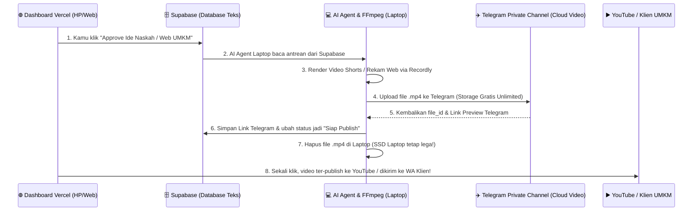

# Arsitektur Teknis: Vercel Dashboard + Supabase Gratis + Telegram Video Cloud

Dokumen ini berisi rancangan teknis siap eksekusi untuk membangun **Command Center Dashboard** kamu, lengkap dengan skema tabel database **Supabase** dan alur penyimpanan video gratis tak terbatas menggunakan **Telegram Bot + Private Channel**.

---

## ⚡ 1. Rahasia Penyimpanan Video Unlimited Rp 0: "Telegram Private Cloud"

Menggunakan **Telegram** sebagai tempat menyimpan hasil render video (`YouTube Shorts` maupun rekaman layar `Recordly` untuk klien UMKM) adalah keputusan paling jenius karena:
1. **Kuota Unlimited (Tak Terbatas):** Kamu bisa mengirim ribuan video `.mp4` (bahkan ukuran hingga 2 GB per file) tanpa biaya sepeser pun.
2. **API Bot Telegram 100% Gratis:** AI Agent di laptopmu bisa meng-*upload* video yang baru selesai di-*render* oleh `FFmpeg`/`AutoShorts` langsung ke **Channel Telegram Pribadi** milikmu chỉ dengan 5 baris kode Python/Node.js.
3. **Notifikasi Instan ke HP:** Saat kamu sedang di kantor dan laptop di rumah selesai me-*render* video Shorts atau membuat demo web UMKM, **HP kamu langsung bunyi notifikasi Telegram** berisi videonya! Kamu tinggal tonton di Telegram, lalu klik tombol **"Approve & Upload ke YouTube"** langsung dari chat Telegram atau dari Dashboard Vercel!



> [!TIP]
> **Keuntungan Tambahan untuk SSD Laptopmu:**
> Begitu video selesai di-*upload* oleh AI Agent ke Telegram, *file* video mentah di laptopmu bisa **otomatis dihapus oleh skrip**. Jadi SSD laptop MSI kamu tidak akan pernah penuh oleh sampah video!

---

## 🗄️ 2. Struktur Tabel Database Supabase (5 Tabel Inti)

Seluruh operasional **3 Sumber Penghasilan + AI Agent + Obsidian Sync** kamu hanya membutuhkan **5 Tabel Ringan** di Supabase.

Berikut adalah kode **SQL Siap Pakai** yang nanti tinggal kamu *Copy-Paste* ke menu **SQL Editor** di Supabase:

```sql
-- 1. TABEL KERJAAN KANTOR & TUGAS HARIAN (Sinkron dengan Obsidian)
CREATE TABLE office_tasks (
    id UUID DEFAULT gen_random_uuid() PRIMARY KEY,
    title TEXT NOT NULL,
    category TEXT DEFAULT 'Kantor', -- 'Kantor', 'Pribadi', 'Riset'
    priority TEXT DEFAULT 'Medium', -- 'High', 'Medium', 'Low'
    status TEXT DEFAULT 'Todo',     -- 'Todo', 'In Progress', 'Done'
    due_date TIMESTAMPTZ,
    ai_summary TEXT,                -- Rangkuman otomatis dari AI Agent
    obsidian_path TEXT,             -- Path file catatan di Obsidian lokal
    created_at TIMESTAMPTZ DEFAULT NOW()
);

-- 2. TABEL AGENSI FREELANCE WEB UMKM (CRM & Pipeline Klien IG)
CREATE TABLE umkm_clients (
    id UUID DEFAULT gen_random_uuid() PRIMARY KEY,
    business_name TEXT NOT NULL,
    niche TEXT,                     -- 'Kuliner', 'Jasa', 'Fashion', 'Klinik', dll
    instagram_handle TEXT,
    whatsapp_number TEXT,
    status TEXT DEFAULT 'Lead',     -- 'Lead', 'Demo Dibuat', 'Dikirim', 'Closing', 'Lunas'
    demo_web_url TEXT,              -- Link preview web di Vercel
    recordly_telegram_url TEXT,     -- Link video demo Recordly yang disimpan di Telegram
    price_Deal NUMERIC DEFAULT 0,
    ai_notes TEXT,                  -- Catatan analisis kebutuhan klien oleh AI
    created_at TIMESTAMPTZ DEFAULT NOW()
);

-- 3. TABEL PABRIK YOUTUBE SHORTS (3 Niche: Islami, Edukasi, Anak)
CREATE TABLE youtube_shorts_queue (
    id UUID DEFAULT gen_random_uuid() PRIMARY KEY,
    niche TEXT NOT NULL,            -- 'Islamic', 'Edukasi', 'Anak_Under7', 'Anak_Over7'
    title TEXT NOT NULL,
    hook_text TEXT,                 -- Kalimat pembuka 3 detik pertama
    full_script TEXT,               -- Naskah lengkap buatan AI Agent
    engine_used TEXT,               -- 'AutoShorts', 'ReelMimic', 'Remotion', 'OpenMontage'
    status TEXT DEFAULT 'Idea',     -- 'Idea', 'Approved', 'Rendering', 'Ready_in_Telegram', 'Published'
    telegram_file_id TEXT,          -- ID Video di Telegram Cloud
    telegram_message_url TEXT,      -- Link langsung untuk tonton video di Telegram
    youtube_url TEXT,               -- Link setelah terupload ke YouTube
    scheduled_at TIMESTAMPTZ,
    created_at TIMESTAMPTZ DEFAULT NOW()
);

-- 4. TABEL ANTREAN PERINTAH AI AGENT (Jembatan Cloud Vercel -> Laptop Lokal)
CREATE TABLE agent_jobs (
    id UUID DEFAULT gen_random_uuid() PRIMARY KEY,
    agent_type TEXT NOT NULL,       -- 'Video_Producer', 'UMKM_Web_Builder', 'Obsidian_Sync', 'Researcher'
    command_payload JSONB NOT NULL, -- Detail perintah yang dikirim dari Dashboard Vercel
    status TEXT DEFAULT 'Pending',  -- 'Pending', 'Running_on_Laptop', 'Completed', 'Failed'
    result_log TEXT,
    created_at TIMESTAMPTZ DEFAULT NOW(),
    completed_at TIMESTAMPTZ
);

-- 5. TABEL SINKRONISASI CATATAN OBSIDIAN (Otak Kedua di Cloud)
CREATE TABLE obsidian_notes_sync (
    id UUID DEFAULT gen_random_uuid() PRIMARY KEY,
    file_path TEXT UNIQUE NOT NULL, -- Contoh: '02-Agensi-UMKM/Klien-Kopi.md'
    title TEXT NOT NULL,
    content_markdown TEXT,          -- Isi catatan yang sudah dikompresi
    tags TEXT[],
    last_synced_at TIMESTAMPTZ DEFAULT NOW()
);
```

---

## 🖥️ 3. Rancangan Tampilan "Command Center Dashboard" di Vercel

Aplikasi web yang akan kita bangun dan *deploy* ke Vercel ini memiliki **5 Fitur Utama dalam 1 Layar**:

1. **📊 Ringkasan Eksekutif Atas (Top Bar):**
   * Target Pendapatan Bulan Ini (Gaji Kantor + *Closing* Web UMKM + Estimasi/Progress *Views* YouTube).
   * Indikator Status Laptop Rumah: 🟢 *Agent Online (Siap Render)* atau ⚪ *Standby (Perintah masuk ke Antrean)*.
2. **🏢 Tab 1: Workspace Kantor:**
   * Daftar tugas kantor hari ini & tombol *"Minta AI Rangkum Dokumen/Rapat"*.
3. **🌐 Tab 2: Mesin Agensi UMKM:**
   * Papan Kanban Klien Instagram.
   * Tombol **"⚡ Generate Demo Web UMKM"** (memerintahkan Sub-Agen membuat *landing page* dari *template* dalam 1 klik).
   * Pemutar/Link Video `Recordly` dari Telegram untuk dikirim ke WhatsApp calon klien.
4. **🎬 Tab 3: Studio Ternak YouTube Shorts:**
   * Filter per Niche: **🕌 Islami** | **🧠 Edukasi** | **🧸 Anak (<7 & >7 Thn)**.
   * Daftar ide & naskah yang dibuat otomatis oleh AI gratis setiap pagi.
   * Tombol **"✅ Setujui & Masuk Antrean Render"** $\rightarrow$ Begitu laptopmu menyala, video otomatis dibuat dan dikirim ke Telegram-mu!
5. **📓 Tab 4: Obsidian Live Reader:**
   * Membaca dan mengedit catatan penting dari Obsidian langsung lewat browser/HP saat kamu tidak membawa laptop.

---

## 🚀 Langkah Eksekusi Sekarang (Siap Dibangun!)

Apakah kamu ingin aku **langsung membuatkan kode proyek Web Dashboard (Next.js + Tailwind + Supabase Integration) beserta skrip Jembatan Telegram & AI Agent-nya** sekarang di dalam *workspace* komputermu?

Jika kamu klik **Proceed** (atau balas setuju), aku akan langsung:
1. Membuat folder proyek di `C:\Users\draconik\.gemini\antigravity\scratch\ai-empire-dashboard`.
2. Membangun aplikasi **Command Center Dashboard** yang ringan, modern, dan siap di-*deploy* ke Vercel.
3. Membuatkan skrip **Local Agent Bridge** (jembatan penghubung antara Supabase, Telegram Bot, Obsidian, dan mesin video di laptopmu).
